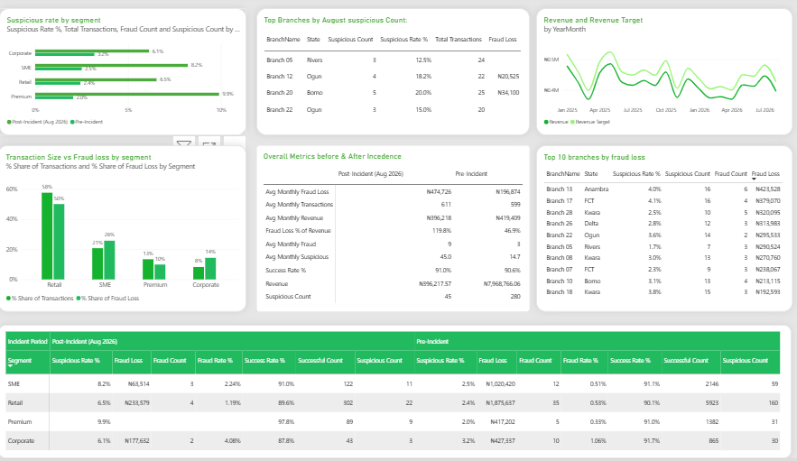
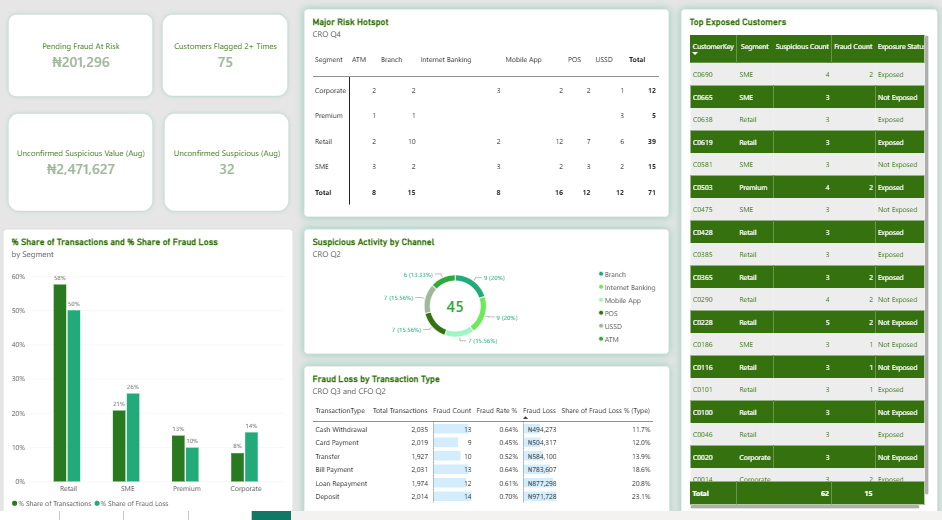
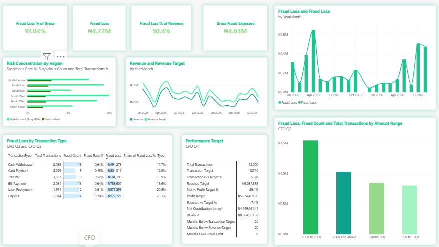

 # Finova Financial Group: Data Breach Impact and Fraud Analysis

**Databeauty Tribe Business Challenge, Case 002** | Power BI · Power Query · DAX | Jan 2025 to Aug 2026

> **Central question from the Executive Board:** *Who is most exposed, where is the risk concentrated, what is the financial impact, and which areas should management prioritise?*

In August 2026, Finova Financial Group (a fictional Nigerian bank) detected unauthorised access to customer contact details. Core banking systems were not compromised, so any damage would show up indirectly, through phishing, impersonation and fraud against customers. This project investigates the business impact for three executives (CEO, CRO and CFO), answers all 15 of their questions with evidence, and ends with a prioritised action plan.

> **Note:** all data is synthetic, supplied by the challenge organisers. It does not represent real bank customers.

---
## Dashboard Preview


## Table of contents
1. [Headline findings](#headline-findings)
2. [Tools and skills](#tools-and-skills)
3. [Data model](#data-model)
4. [Data preparation log](#data-preparation-log)
5. [Definitions and assumptions](#definitions-and-assumptions)
6. [Answers by stakeholder](#answers-by-stakeholder)
7. [Recommendations](#recommendations)
8. [Limitations](#limitations)
9. [Dashboard](#dashboard)
10. [Key DAX and Power Query](#key-dax-and-power-query)
11. [Repository structure](#repository-structure)
12. [Author](#author)

---

## Headline findings

| | Finding |
|---|---|
| **Where the impact is** | In **risk**, not in business performance. August suspicious activity was 45 against a 19-month average of 14.7, and more than double the previous monthly high (21). Transactions, success rate and revenue stayed within their normal ranges |
| **Financial impact** | Confirmed fraud cost **₦4.2M** (63 successful fraudulent transactions), equal to **50% of all fee income**. 91% of attempted fraud value (₦4.63M) got through |
| **August loss** | ₦475K, about 2.4x a typical month and **120% of that month's fee income** (47% before the incident) |
| **Who is affected** | Depends on the measure: Premium shows the sharpest rise in suspicious activity, Retail carries the most money (50% of losses), Corporate and SME lose more than their size suggests |
| **Where** | North Central has 20% of transactions but **35% of fraud loss**. South West (via Ogun) and North East (via Borno) spiked fastest |
| **Exposure** | 398 of 800 customers (50%) were exposed, yet exposed customers make up the same share of August flags (51%). **Exposure does not predict who is targeted** |
| **Biggest lever** | All 63 loss transactions had been flagged suspicious but still completed. Holding flagged transactions above ₦100K would have addressed **₦2.57M (61% of losses)** while delaying 45 legitimate transactions in 20 months |
| **Not the incident** | Revenue missed target by 7.4% to 8.0% in **every one of the 20 months**, long before the breach |

---

## Tools and skills

| Area | Tools |
|---|---|
| BI and visualisation | Power BI Desktop |
| Data preparation | Power Query (M) |
| Modelling | Star schema, relationships, date table, bridge dimension |
| Calculations | DAX (measures, calculated columns, field parameter, variables) |
| Validation | Python (pandas) for independent cross-checks of the Power BI figures |
| Communication | Executive dashboard, stakeholder-based storytelling, recommendations |

---

## Data model

A single-fact star schema, as the challenge requires. `Fact_Transactions` is the only fact table.

```
Dim_Date ──────┐
Dim_Customer ──┤── Dim_CustomerSegment
Dim_Account ───┤
Dim_Branch ────┤── Dim_Region
Dim_Channel ───┤
Dim_TransactionType ┘
          │
   Fact_Transactions            Dim_Month ──┬── Dim_Date[YearMonth]
                                            └── Targets[Month]
```

| # | From (many) | To (one) |
|---|---|---|
| 1 | Fact_Transactions[DateKey] | Dim_Date[DateKey] |
| 2 | Fact_Transactions[CustomerKey] | Dim_Customer[CustomerKey] |
| 3 | Fact_Transactions[AccountKey] | Dim_Account[AccountKey] |
| 4 | Fact_Transactions[BranchKey] | Dim_Branch[BranchKey] |
| 5 | Fact_Transactions[ChannelKey] | Dim_Channel[ChannelKey] |
| 6 | Fact_Transactions[TransactionTypeKey] | Dim_TransactionType[TransactionTypeKey] |
| 7 | Dim_Branch[RegionKey] | Dim_Region[RegionKey] |
| 8 | Dim_Customer[Segment] | Dim_CustomerSegment[Segment] |
| 9 | Dim_Date[YearMonth] | Dim_Month[YearMonth] |
| 10 | Targets[Month] | Dim_Month[YearMonth] |

**Design decisions**
- **`Dim_Month` bridge.** Targets are monthly, but `Dim_Date[YearMonth]` repeats on every day. A 20-row month dimension gives both a unique key, avoiding a many-to-many relationship.
- **No Account → Customer relationship.** The fact table already holds both keys, so adding it would create a second path and deactivate the direct one.
- **All relationships are single-direction,** with dimensions on the "one" side.
- **Measures are grouped into separate measure tables** by theme (core, rates, risk counts, revenue, fraud outcomes, exposure, incident comparison, statuses).

---

## Data preparation log

Every cleaning step was reconciled before and after.

| Step | Finding | Action |
|---|---|---|
| **Data types** | Dates, currency and keys needed explicit types | Keys as Text, amounts as Fixed Decimal, DateKey as Date; `Targets[Month]`, `Dim_Date[YearMonth]` and `Dim_Month[YearMonth]` kept consistent so the relationships work |
| **Flags** | `SuspiciousFlag`, `FraudFlag` and `DataExposed` held Yes/No text | Converted to True/False for simpler, safer DAX; `Exposure Status` text label added for reporting |
| **Text consistency** | No leading or trailing spaces, case variants or blanks; Status has exactly four valid values | Trim and Clean applied as a safeguard |
| **Duplicates** | 5 exact duplicate rows (T000100, T000201, T000302, T000403, T000504) appended at the end | Removed on TransactionID: 12,005 to **12,000** rows. None were flagged suspicious or fraud, so risk metrics were unaffected |
| **Missing values** | 21 blank `Amount` values (0.175%): 18 Successful, 2 Pending, 1 Failed; none suspicious or fraud; all have valid FeeIncome | Kept as null (not deleted, not imputed). `AmountMissing` flag added to quantify impact: ₦7,916 of fee income (0.095%), est. 0.1% to 0.2% understatement of total value |
| **Referential integrity** | No orphan keys across any relationship; Account to Customer consistent for all rows | Documented as tested and clean |
| **Flag logic** | All 71 fraud transactions are also flagged suspicious | Verified with a measure that returns 0 |

**Reconciliation**

| Metric | Before | After |
|---|---|---|
| Rows | 12,005 | 12,000 |
| Total Amount | 872,645,481.08 | 872,333,834.55 |
| Total FeeIncome | 8,368,104.84 | 8,364,983.63 |
| Suspicious (True) | 325 | 325 |
| Fraud (True) | 71 | 71 |
| Fraud loss | 4,215,322.22 | 4,215,322.22 |

**Derived columns:** `AmountMissing`, `Risk Category` (Confirmed Fraud - Loss / Confirmed Fraud - Not Realised / Suspicious Only / Normal), `Incident Period` (Pre-Incident / Post-Incident), `Amount Band`.

---

## Definitions and assumptions

- **Suspicious is not confirmed fraud.** They are reported separately throughout.
- **Revenue = `FeeIncome`.** Fees are recorded on failed, pending and reversed transactions too (₦779K, 9.3% of the total), so realised revenue (successful only) is also reported.
- **Fraud loss = amount of fraud-flagged transactions with Status = Successful.** Failed, reversed and pending fraud did not (or has not yet) cost money. Gross fraud exposure is reported alongside.
- **Net contribution (proxy) = Revenue minus Fraud loss.** The dataset has no cost data, so true profit cannot be computed and this is indicative only.
- **Baseline vs post-incident.** January 2025 to July 2026 (19 months) is the baseline, compared with August 2026 (one month), so comparisons use **monthly averages and rates**.
- **Association, not causation.** The data shows the August spike coincides with the incident month. It cannot show cause.

---

## Answers by stakeholder

### CEO

| Question | Answer |
|---|---|
| **1. Overall impact?** | Risk, not performance. Suspicious activity about 3x normal (45 vs 14.7), confirmed fraud 9 vs 3.3 (limit 12), fraud loss ₦475K vs ₦197K. Transactions (611 vs 599), success rate (91.0% vs 90.6%) and revenue (₦396K vs ₦419K) within normal ranges |
| **2. Segments most affected?** | **Premium** has the sharpest rise (suspicious rate 2.0% to 9.9%) but no confirmed fraud yet. **Retail** carries the most money (₦2.1M, 50%). **Corporate** (8% of transactions, 14% of loss; 1.21% fraud rate) and **SME** (21% and 26%) lose more than their size suggests. Exposure is similar across segments (about 47% to 60%) |
| **3. Regions and branches?** | North Central: 20% of transactions, 35% of loss. South West (2.2% to 10.0%, driven by Ogun) and North East (2.6% to 9.3%, driven by Borno) spiked fastest. Ten branches hold about 70% of fraud loss. Four branches (20, 12, 22, 05) account for 15 of August's 45 flags |
| **4. Has activity changed?** | No meaningful change yet. All activity metrics sit inside their pre-incident ranges. Average amount dipped 7% but the median is flat |
| **5. What to prioritise?** | See [Recommendations](#recommendations) |


### CRO

| Question | Answer |
|---|---|
| **1. Segments with highest exposure?** | As CEO Q2 |
| **2. Channels with most suspicious activity?** | All six channels rose 2.6x to 4.0x, so the spike is bank-wide. Branch (9.0%) and Internet Banking (8.7%) are highest with 9 flags each; Internet Banking rose fastest (2.2% to 8.7%) |
| **3. Types most associated with fraud?** | Deposit (14 cases, 0.70%), then Bill Payment and Cash Withdrawal (13), Loan Repayment (12). Card Payment lowest (9, 0.45%). The spread is narrow |
| **4. Major hotspots?** | **Retail × Mobile App**: 12 of 71 cases, 1.04% fraud rate vs 0.56% for Retail, ₦838K (20% of losses). North Central shows repeated cases across ATM, POS, Mobile App and Branch (20 cases) |
| **5. Immediate monitoring?** | 4 confirmed-fraud transactions still Pending for 8 to 19 months (₦201K); 32 successful August transactions flagged but unconfirmed (₦2.47M); 75 customers flagged two or more times (19 three or more; 7 with two or more confirmed frauds) |



### CFO

| Question | Answer |
|---|---|
| **1. Financial impact?** | ₦4.2M fraud loss, 50% of fee income, 0.48% of transaction value. Only ₦415K (9%) of attempted fraud was stopped. Loss was easing until July 2026; July (₦506K) and August (₦475K) each exceeded that month's fee income |
| **2. Types driving loss?** | Deposit (₦972K, 23%), Loan Repayment (₦877K, 21%), Bill Payment (₦784K, 19%): together 62%. Cash Withdrawal has 13 fraud cases but only 12% of loss (smaller tickets, 4 never completed) |
| **3. Regions and branches?** | As CEO Q3 |
| **4. Actual vs targets?** | Revenue ₦8.36M vs ₦9.04M (-7.4%); transactions 12,000 vs 12,710 (-5.6%); both missed in 20 of 20 months. Fraud cases never exceeded the monthly limit. Profit proxy 29% below target (indicative) |
| **5. Greatest loss-reduction opportunity?** | Stop flagged transactions before they settle (below) |




**The loss-reduction rule, tested on the data**

| Hold flagged transactions above | Held | Frauds stopped | Loss prevented | Legitimate delayed |
|---|---|---|---|---|
| Any amount | 296 | 63 | ₦4.22M (100%) | 233 |
| ₦50K | 131 | 27 | ₦3.37M (80%) | 104 |
| **₦100K** | **60** | **15** | **₦2.57M (61%)** | **45** |

Fraud occurs at a similar rate in every amount band; losses concentrate in large tickets because of their size.

---

## Recommendations

| # | Priority | Action | Evidence | Timing |
|---|---|---|---|---|
| 1 | **Stop fraud before it settles** | Hold flagged transactions above ₦100K for review | 15 flagged transactions above ₦100K = ₦2.57M (61% of losses); about two legitimate customers a month delayed | 30 days |
| 2 | **Clear the backlog** | Resolve 4 pending fraud cases; review 32 unconfirmed August flags; investigate repeat-flagged customers | ₦201K pending 8 to 19 months; ₦2.47M flagged and unreviewed; 75 customers flagged 2+ times | This week |
| 3 | **Monitor the hotspots** | Enhanced monitoring on Retail × Mobile App, North Central and Branches 20, 12, 22, 05 | 12 cases and ₦838K; 35% of loss; 15 of 45 August flags | 30 days |
| 4 | **Protect all customers** | Phishing and impersonation warnings to everyone, not only exposed customers | Exposed customers make up 51% of August flags, matching their 50% share of the base | 30 days |
| 5 | **Track early-warning indicators** | Weekly report: suspicious count, fraud vs limit, pending age, activity and success rate | Suspicious activity more than doubled while activity is still stable | Ongoing |
| 6 | **Housekeeping** | Review targets and fees recorded on non-completed transactions | 7.4% to 8.0% revenue gap in every month; ₦779K of fees on failed, pending and reversed transactions | Next quarter |

---

## Limitations

- **One post-incident month.** Any delayed effect on customer behaviour cannot yet be seen.
- **Small samples.** 71 confirmed fraud cases in total; segment, branch and channel rankings can shift on one or two transactions, and are treated as signals to monitor.
- **Flag timing is unknown.** The ₦100K hold rule assumes the suspicious flag is raised before settlement, and the result is an upper bound tested on the same data.
- **No cost or complaints data.** Profit cannot be measured, and complaints mentioned in the brief are not in the dataset.
- **Correlation, not causation.** The data cannot show why the August spike happened.

---

## Dashboard

Pages are arranged by stakeholder question, with headline-style titles.

| Page | Answers |
|---|---|
| **CEO: Impact and Activity** | Q1, Q4 |
| **CEO: Who is Affected** | Q2 |
| **CEO: Where to Focus** | Q3 |
| **CRO: Risk Hotspots** | Q2 to Q5 |
| **CFO: Financial Impact** | Q1 to Q5 |


## Author

**Rokeeb Bashir** | Data Analyst | Lagos, Nigeria
GitHub: [github.com/Ranky13](https://github.com/Ranky13) · LinkedIn: [linkedin.com/in/rokeeb-bashir](https://linkedin.com/in/rokeeb-bashir)

*Independent submission for the Databeauty Tribe Business Challenge (Case 002). All data is synthetic.*
